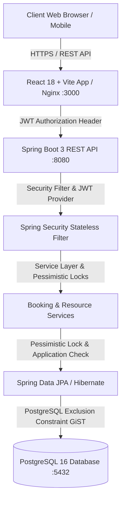
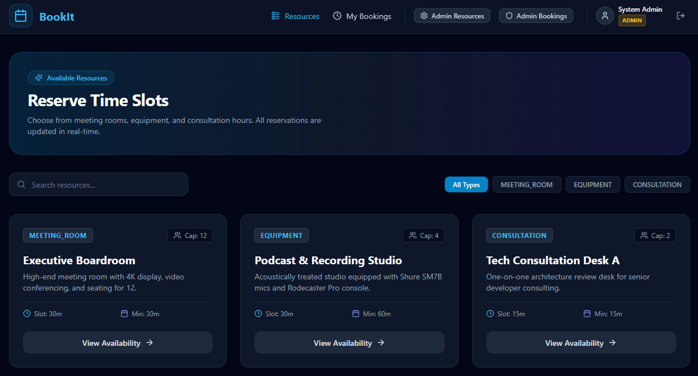
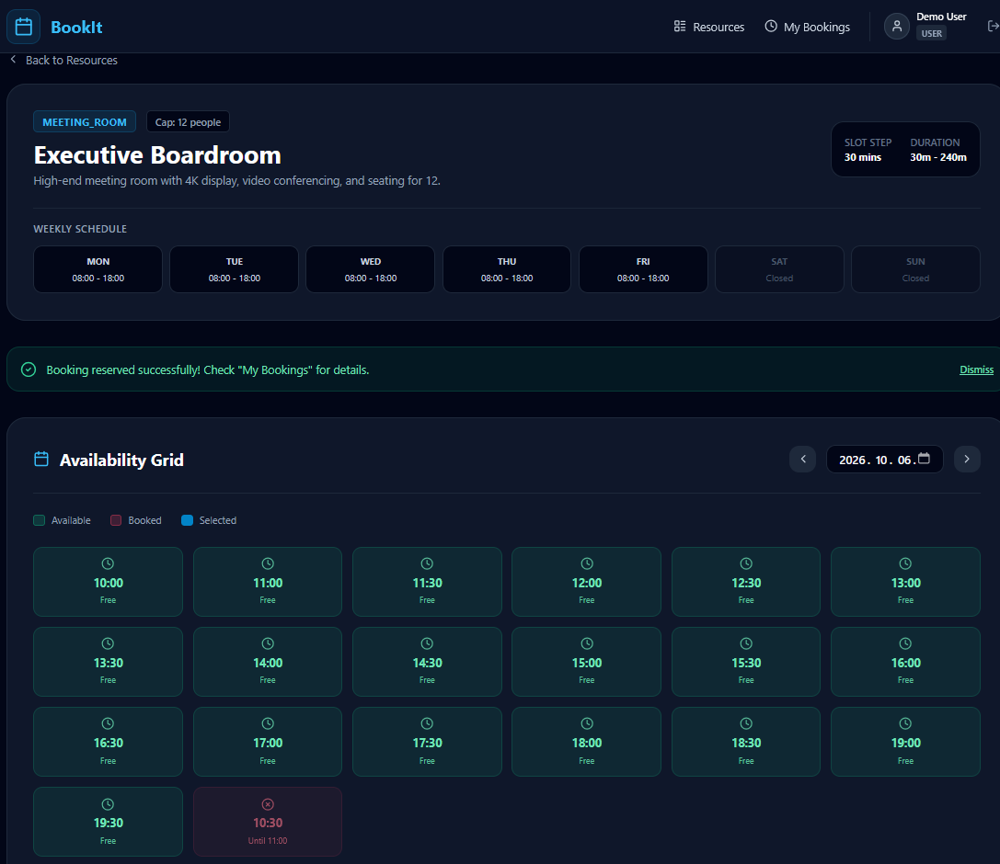
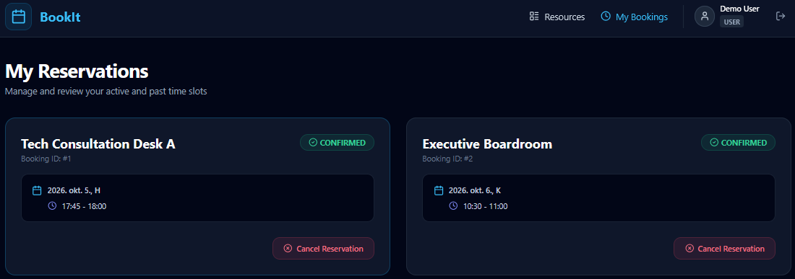
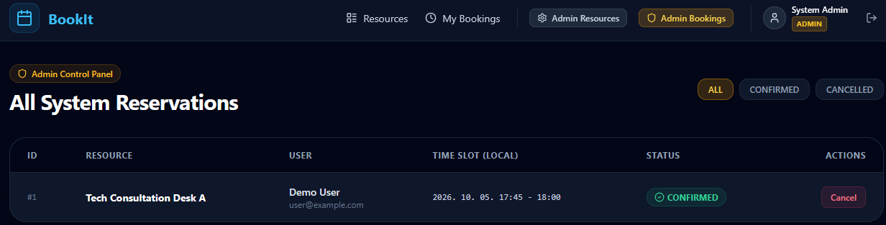
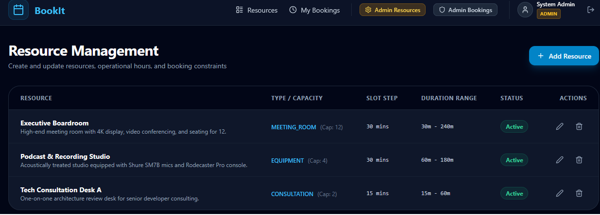

# Resource & Appointment Booking System

A full-stack booking system built with **Java 21, Spring Boot 3, React 18, and PostgreSQL 16**. The system features **defense-in-depth double-booking prevention**, real-time slot availability computation, role-based authorization, and single-command local deployment via Docker Compose.

---

## Key Features

- **Authentication & Role-Based Authorization:** Stateless JWT access tokens with BCrypt password hashing. Separate permissions for `ROLE_USER` and `ROLE_ADMIN`.
- **Resource Management:** Admins configure resources with customizable slot granularity (15/30/60 mins), min/max booking durations, capacity, and per-weekday opening hours.
- **Availability Calculation:** Real-time calculation of free vs booked time slots over any date range, respecting operational opening hours and slot alignment.
- **Concurrency-Safe Reservation Engine:** Defense-in-depth protection against double-booking using **Application-level Pessimistic Locking** (`PESSIMISTIC_WRITE`) combined with a **PostgreSQL Exclusion Constraint** (`GiST` range index).
- **Interactive Web Interface:** Modern, responsive dark-mode React application powered by Vite, Tailwind CSS, TanStack Query, and React Hook Form + Zod.
- **OpenAPI / Swagger Integration:** Interactive API documentation with JWT Bearer scheme integration at `/swagger-ui.html`.

---

## Tech Stack

### Backend
- **Core:** Java 21, Spring Boot 3.3.4, Maven
- **Security:** Spring Security (Stateless JWT, BCrypt)
- **Database & Migration:** PostgreSQL 16, Flyway (`btree_gist` extension, no schema auto-generation)
- **API & Docs:** Spring Web, Bean Validation, springdoc-openapi (Swagger UI)
- **Testing:** JUnit 5, Mockito, Spring Boot Test, MockMvc, Testcontainers

### Frontend
- **Core:** React 18, TypeScript (Strict Mode), Vite
- **Styling:** Tailwind CSS, Lucide React icons
- **State & Routing:** TanStack Query (v5), React Router v6
- **Forms & Validation:** React Hook Form, Zod
- **Testing:** Vitest, React Testing Library

### Infrastructure & CI
- **Orchestration:** Docker & Docker Compose (`postgres:16-alpine`, Java 21 JRE container, Nginx frontend container)
- **Continuous Integration:** GitHub Actions workflow building and testing both services on every push/PR.

---

## System Architecture Diagram



---

## Quick Start (Single Command)

### Prerequisites
- Docker Engine 24+ & Docker Compose v2+ installed.

### Run End-to-End locally:
1. Copy the example environment file:
   ```bash
   cp .env.example .env
   ```

2. Launch all containers with Docker Compose:
   ```bash
   docker compose up --build
   ```

3. Open your browser:
   - **Frontend App:** [http://localhost:3000](http://localhost:3000)
   - **Backend API:** [http://localhost:8080/api/v1](http://localhost:8080/api/v1)
   - **Interactive OpenAPI Documentation:** [http://localhost:8080/swagger-ui.html](http://localhost:8080/swagger-ui.html)

---

## Pre-Seeded Demo Credentials

The database is automatically initialized with sample resources and seeded user accounts via Flyway migration `V5__seed_demo_data.sql`:

| Role | Email | Password | Access Level |
| :--- | :--- | :--- | :--- |
| **Admin** | `admin@example.com` | `AdminPassword123!` | Resource CRUD, view all bookings, cancel any booking |
| **Demo User** | `user@example.com` | `UserPassword123!` | View resources, availability grid, reserve & cancel own bookings |

---

## Concurrency Protection & Trade-Off Summary

Double-booking prevention is enforced via **Defense-in-Depth**:
1. **Layer 1 (Application & Pessimistic Locking):** The backend acquires a DB row lock (`SELECT FOR UPDATE`) on the target resource during booking creation, serializing concurrent requests for the same resource and executing `existsOverlappingBooking`.
2. **Layer 2 (PostgreSQL Engine Exclusion Constraint):** Flyway creates a PostgreSQL exclusion constraint:
   ```sql
   ALTER TABLE bookings
   ADD CONSTRAINT no_overlapping_bookings
   EXCLUDE USING gist (
       resource_id WITH =,
       tstzrange(start_time, end_time, '[)') WITH &&
   ) WHERE (status = 'CONFIRMED');
   ```
3. **Layer 3 (HTTP 409 Conflict):** `GlobalExceptionHandler` converts overlap exceptions and constraint violations into HTTP 409 Conflict JSON error responses.

*For full trade-off analysis comparing pessimistic locking, optimistic locking, DB constraints, and serializable isolation, see [docs/architecture.md](docs/architecture.md).*

---

## Running Automated Tests

### Backend Test Suite (Includes Concurrency Test)
The backend test suite executes unit tests, MockMvc security tests, and a multi-threaded `ExecutorService` concurrency test:
```bash
cd backend
./mvnw clean test
```

### Frontend Test Suite & Production Build
```bash
cd frontend
npm ci
npm run test
npm run build
```

---

## Documentation Links & ADR Notes
- **[Architecture & ER Model](docs/architecture.md):** ER diagram, concurrency trade-offs, and security architecture.
- **[ADR 001: PostgreSQL Exclusion Constraints](docs/adr/ADR-001-postgre-exclusion-constraint-for-concurrency.md)**
- **[ADR 002: Stateless JWT Authentication](docs/adr/ADR-002-stateless-jwt-authentication.md)**
- **[ADR 003: Pessimistic Row-Level Locking](docs/adr/ADR-003-pessimistic-row-locking.md)**
- **[ADR 004: TanStack Query Server State](docs/adr/ADR-004-tanstack-query-for-server-state.md)**

---

## Future Enhancements
- Recurring booking rules (weekly/monthly series).
- Email notifications (mocked/Spring Mail).
- Resource utilization statistics & admin dashboard graphs.

## Images




