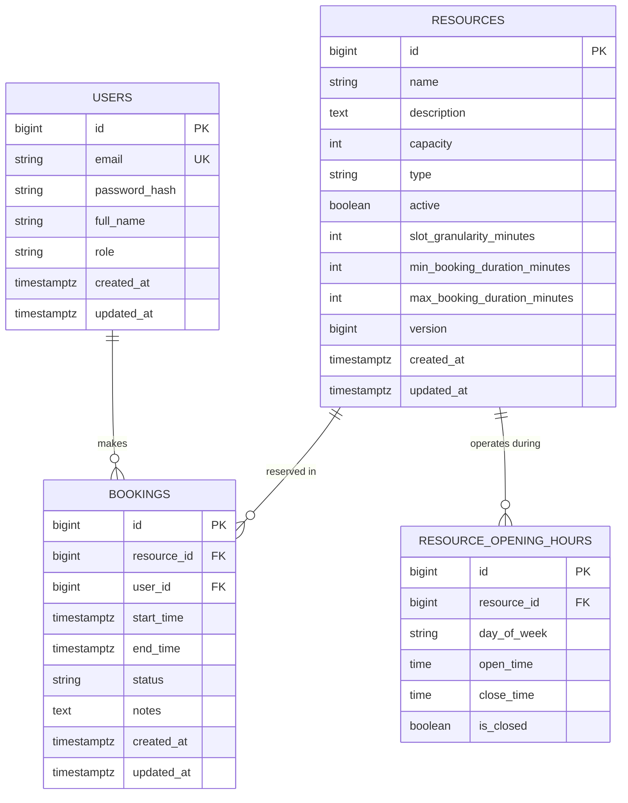

# System Architecture & Technical Design

## 1. Entity-Relationship (ER) Data Model



---

## 2. Concurrency Control Strategy & Trade-Off Analysis

Preventing double-booking under high concurrent load is the core technical challenge of this application. We implement **Defense-in-Depth** across three complementary layers:

### Layer 1: Application-Level Check & Row-Level Pessimistic Locking
- **Mechanism:** During reservation processing, the service acquires a DB-level pessimistic write lock (`SELECT FOR UPDATE`) on the target `Resource` row before running the overlap check (`existsOverlappingBooking`).
- **Effect:** Serializes concurrent reservation attempts targeting the same resource. The first transaction locks the resource, verifies slot availability, inserts the booking, and commits. Subsequent transactions wait for the lock and then evaluate `existsOverlappingBooking`, which immediately returns `true` (slot taken), triggering a clean **HTTP 409 Conflict** error response.

### Layer 2: PostgreSQL Engine Exclusion Constraint
- **Mechanism:** Implemented via Flyway migration using the PostgreSQL `btree_gist` extension:
  ```sql
  ALTER TABLE bookings
  ADD CONSTRAINT no_overlapping_bookings
  EXCLUDE USING gist (
      resource_id WITH =,
      tstzrange(start_time, end_time, '[)') WITH &&
  ) WHERE (status = 'CONFIRMED');
  ```
- **Effect:** Acts as the ultimate database engine guarantee. Even if multiple application server nodes run concurrently without shared memory, PostgreSQL guarantees at disk/index level that two overlapping non-cancelled time ranges cannot exist for the same `resource_id`.

### Layer 3: Optimistic Locking (`@Version`)
- **Mechanism:** The `Resource` entity includes a `@Version Long version;` column managed by Hibernate.
- **Effect:** Prevents lost updates when administrators modify resource settings or opening hours simultaneously.

---

### Trade-Off Comparison Matrix

| Approach | Pros | Cons | Decision |
| :--- | :--- | :--- | :--- |
| **Application Overlap Check Alone** | Easy to implement | Prone to race conditions under concurrent requests in READ_COMMITTED isolation. | Used as initial validation |
| **Pessimistic Locking (`FOR UPDATE`)** | Guarantees thread safety; predictable error handling | Slightly reduces throughput for the *same* resource during concurrent bursts | **Adopted (Layer 1)** |
| **PostgreSQL Exclusion Constraint (`GiST`)** | Zero race condition possibility; enforced by DB kernel regardless of client count | Database vendor specific (PostgreSQL with `btree_gist`) | **Adopted (Layer 2)** |
| **Serializable Isolation Level** | Strongest standard SQL isolation | High rate of serialization failures requiring application retries; higher overhead | Avoided in favor of targeted locking |
| **Optimistic Locking (`@Version`)** | Excellent for read-heavy entities with infrequent edits | Not suitable for booking slot creation where rows don't exist yet | **Adopted for Resource updates** |

---

## 3. Security Model

- **Authentication:** Stateless JSON Web Tokens (JWT) generated via HMAC SHA-256 (`jjwt`).
- **Password Protection:** BCrypt hashing (cost factor 10) applied before persistence.
- **Authorization:** Role-Based Access Control (`ROLE_USER` vs `ROLE_ADMIN`) using Spring Security `@PreAuthorize` annotations.
- **Ownership Scoping:** Regular users can only query and cancel their own bookings (`booking.getUser().getId() == currentUser.getId()`). Administrators can inspect and override any booking.
